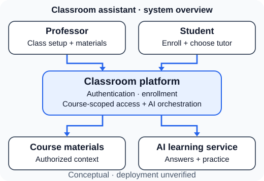

# AI Classroom Assistant

*System architecture & engineering leadership case study*

> **Portfolio case study — not the original application source code.** I led product definition, system architecture, MVP scoping, engineering coordination, and delivery oversight for an AI-assisted classroom platform at Anvillent. Four engineers on the distributed development team implemented the application. I have confirmed that the team completed a functional MVP; the original implementation, test reports, and deployment evidence are not available for independent verification.

**The challenge:** Give professors a structured way to create classes and share materials while allowing enrolled students to ask course-specific questions and practice concepts with AI. The initial product vision included additional media, LMS, and assessment features that needed to be kept out of the first release.

**My contribution (first-hand account):** Translated that vision into a scoped V1 specification, mapped professor/student workflows, prioritized dependent features, coordinated four engineers in India, led sprint planning and integration priorities, and oversaw QA and delivery. These personal responsibilities are reported from my experience, **not independently attested by the PRD or timeline**. **I did not write the application's implementation code.**

**Reported outcome:** An integrated, functional MVP completed by the engineering team, based on my first-hand confirmation. Production deployment, adoption, performance, and operating metrics have not been established.

## MVP at a glance

| Experience | V1 requirements |
| --- | --- |
| Professor | Sign in; create/select a class; manage outlines, topics, files and class codes independently; optionally start without files |
| Student | Sign in; find/join a class using its code; access the class context; select Q&A or concept learning |
| Course Q&A | Use relevant subject material as context for answers to student questions |
| Concept learning | Explain concepts, provide the original diagram’s three-problem practice set, evaluate responses, and guide retry/progression |
| Later releases | Generated lectures, direct Canvas/LMS integrations, on-platform assessments, adaptive recommendations, and voice interactions |

The source PRD includes *storing exam/quiz information and resources* in V1 without prescribing an exclusive file format; **interactive on-platform quizzes** are future scope. This distinction affects both requirements and test design.

## Architecture overview

[Open the detailed system architecture and full service/data-flow diagram](diagrams/system-context.svg) for zoomable technical review. The compact figure summarizes the principal relationships on smaller screens.

The documented historical technology stack was **React, Python/Flask, GPT-4, AWS S3 and AWS EC2** (reported by the project lead). The diagram is a **reconstructed logical architecture**, not a diagram of verified deployed infrastructure. The source documents do not establish a database product, API route contracts, model prompting, retrieval library, or deployment topology.

## How to review this case study

1. [Requirements and MVP boundaries](docs/requirements.md) — original functional scope, future scope, ambiguities and acceptance rules.
2. [System architecture](docs/system-architecture.md) — responsibility boundaries, data movement, trust boundaries and failure handling.
3. [Professor/student workflows](docs/workflows.md) — reconstructed workflows grounded in the original flowcharts.
4. [AI learning design](docs/ai-learning.md) — behavior of the two tutoring modes, with unresolved implementation choices marked.
5. [Traceability matrix](docs/traceability.md) — 18 traceable requirements (including explicit classroom creation), source locators and dependencies, generated from structured specifications.
6. [Engineering delivery](docs/delivery.md) — original six-week workstream plan and engineering coordination analysis.
7. [Architecture decisions](docs/architecture-decisions.md) — alternatives, tradeoffs and technical assumptions.
8. [Assertion-level coverage](docs/acceptance-coverage.md) — independent, positive/negative/failure oracles mapped to requirements.
9. [Validation and risks](docs/validation-and-risk.md) — test design, access control and AI reliability gaps.
10. [Evidence and limitations](docs/provenance.md) — what is documented, reported, reconstructed and not verified.
11. [Material claim/evidence register](docs/evidence-register.md) — approved source categories, wording limits and prohibited unsupported assertions.

**Proposed validation inventory:** 18 source-backed requirements and 18 synthetic acceptance scenarios, including S18 for reopened existing classes; these are not executed historical tests.

**Additional artifacts:** [rights and reuse](RIGHTS.md) · [deterministic build script](tools/build_release.py) · [hosted validation workflow](.github/workflows/validate.yml) · [five detailed technical diagrams and three compact overviews](diagrams/) · [synthetic acceptance scenarios](examples/synthetic-acceptance-scenarios.md) · [structured requirements](data/requirements.json) · [structured acceptance cases](data/acceptance-cases.json) · [specification renderer](tools/render_specs.py) · [documentation QA checker](tools/check_docs.py) · [checker mutation tests](tools/test_check_docs.py) · [prospective risk test designs](docs/risk-acceptance-tests.md) · [attribution](ATTRIBUTION.md).

**Verification:** The exact V18 ZIP has one independently published SHA-256; confirm it **before executing its scripts**. Then run `python3 tools/check_docs.py --strict-release` and the included tests. Git checkouts use direct working-file SHA-256 and isolated, read-only Git object verification—not Git status or a custom ZIP parser. See [release verification](docs/release-verification.md), the [coverage matrix](docs/release-coverage-matrix.md), and the [review protocol](docs/review-protocol.md). No GitHub publication has been authorized in this task.

## Evidence standard

- **Original evidence:** A V1/full-outcome PRD (including professor/student diagrams) and a six-week engineering plan, reviewed privately for this case study. Neither original document is redistributed here.
- **First-hand account:** I directed the work and confirmed completion of a functional MVP. The original PRD and timeline do not independently establish my personal role/individual ownership; these statements are historical testimony, not an independent code or deployment audit.
- **Reconstructed material:** The architecture diagrams, interface responsibilities, quality criteria, risk controls, and acceptance scenarios are newly authored interpretations or recommendations. They do not assert undocumented implementation details.
- **Estimates:** The source PRD and roadmap contain conflicting planning totals; no actual engineering-hour or delivery-duration claim is made here.

**Publication authorization (owner-provided premise):** Employer intellectual-property and disclosure permission is treated as granted under the project owner’s express instruction on 2026-11-12. This portfolio excludes original source documents and does not assert employer endorsement. No GitHub publication has been authorized in this task; see the [publication-safety review](docs/publication-safety.md), [provenance](docs/provenance.md), and [attribution](ATTRIBUTION.md).
