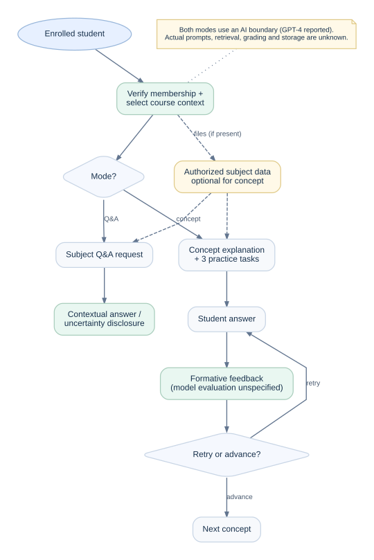

# AI learning experience and interaction boundaries

**Source-backed product behavior:** The V1 PRD (§2.2, pp. 2–3), student flowchart (p. 5) and engineering timeline (Weeks 5–6) specify a subject-aware Q&A bot and a concept learning bot. They do **not** establish the real prompt instructions, embedding strategy, retrieval implementation, model temperature, vendor logging settings or answer-scoring algorithm.

## Shared prerequisites

An authenticated student must identify and join a class; tutoring sessions must be associated with the selected class. That class **may have zero uploaded academic files**. The original flowchart mentions preparing subject context before branching into the bots. **How that context was transformed or passed to GPT-4 is unknown.** Q&A retrieval is one mode-specific operation, not a prerequisite for all concept practice.

A conceptual interaction envelope would contain (a) an authorized classroom selection, (b) tutoring mode, (c) student utterance or answer, and (d) permitted subject context. These are **semantic requirements, not historical request fields**.

## Mode A: course Q&A

**Goal:** Respond to course or subject questions using relevant teaching material.

Conceptual path: student submits question → classroom authorization → eligible source-context selection → AI-generated answer → student receives answer or a clearly described information limitation.

**Source basis:** V1 lists *Retrieve Subject Data* and *Answer Subject-Based Questions*; the source diagram links course document data to a Q&A response.

**Proposed acceptance design:** Use two deliberately contradictory, instructor-defined synthetic checkpoints (Calculus A: `Willow-7 = violet compass`; Physics B: `Willow-7 = copper lantern`) plus an isolated no-context control. Check both the output marker and authorized model-visible material when instrumentation is available; otherwise mark retrieval-grounding **INCONCLUSIVE**, not PASS. An inability-to-retrieve message **fails the healthy case** and belongs only to missing/unreadable-context cases. A 2/2 accuracy and 2/2 source-support reviewer score is required, but context selection and correct output cannot prove perfect causal dependence. Full test oracles appear in [synthetic scenarios](../examples/synthetic-acceptance-scenarios.md). No historical metrics are established.

## Mode B: concept learning and practice

**Goal:** Help students strengthen understanding through explanations and applied practice.

Conceptual path: choose concept/topic → get explanation → receive **three distinct practice problems** (as drawn in the source student flowchart) → submit attempt → receive evaluative feedback → retry or advance. The source includes both correct/incorrect branches.

**Source basis:** V1 lists *Explain Concepts & Provide Practice Problems* and *Evaluate Answers*. The source student flowchart specifically labels **three** practice problems and shows retry after incorrect responses.

**Proposed acceptance design:** Review the initial explanation independently and verify exactly three mathematically valid, distinct exercises (derivatives of `2x`, `x²` and `3x+1`, with expected answers `2`, `2x` and `3`). Then test wrong-answer retry and correct-answer progression separately. A wrong answer must produce corrective feedback and an opportunity to retry; a correct answer must provide an observable advance-to-next-concept path. Ambiguous responses invite clarification. Practice evaluation remains formative and must **not imply official grades, institution-approved scoring, or a verified correctness guarantee**.

## Failure modes and proposed safeguards

| Situation | Risk | Proposed product behavior | Evidence status |
| --- | --- | --- | --- |
| Empty or unprocessed class | Inventing course-backed content | State source context is unavailable; suggest adding or consulting class materials | Not specified historically |
| Student requests another class's content | Resource/privacy leak | Deny before retrieval or AI call | Not specified historically |
| Uploaded material contains malicious instructions | Prompt injection or data exfiltration | Treat document as data, delimit it, enforce authorization before model requests | Not specified historically |
| Course material contradicts model knowledge | Unsupported confidence | Identify conflict/uncertainty rather than fabricate authority | Not specified historically |
| Model returns mistaken answer | Mislearning | Encourage comparison with course material, allow correction/reporting | Not specified historically |
| Practice response is partially correct | Incorrect hard-fail | Explain evaluation uncertainty; allow follow-up | Not specified historically |
| Model provider unavailable | Broken workflow | Clear recoverable error without losing student answer where appropriate | Not specified historically |
| Sensitive student information appears in prompt | Privacy/retention concern | Minimize data and review provider processing/retention terms | Not specified historically |

## Integration decisions intentionally left open

- **Source context:** full-document prompting versus passage selection or indexing is not documented.
- **Freshness:** how edited professor materials become available to tutoring is unspecified.
- **Length:** truncation/chunk limits and oversized documents are unspecified.
- **Model:** GPT-4 was reported; release snapshot, prompt details and fine-tuning were not provided.
- **Evaluation:** rule-based checks, model-based checks, reference answers and their reliability are unknown.
- **Retention:** storage of chat history, user consent and retention periods are unknown.

The design deliberately refrains from inventing a RAG architecture, vector database, prompt examples or evaluation benchmark. The product's **behavioral contracts** are the legitimate architectural subject of this portfolio.

**Optional concept-source context:** The dashed document-to-concept path in the AI interaction diagram is conditional, not a prerequisite. A concept lesson can use a topic with no uploaded material in the prospective fixture; when material is used, it must be authorized for the class. This does not assert how the historical implementation handled missing files.
