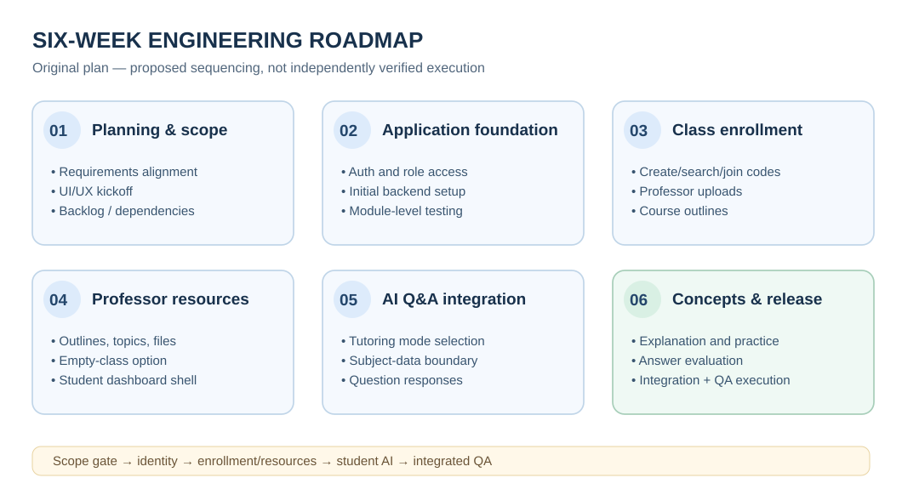

# Engineering delivery — six-week planning case study

**Historical evidence:** Anvillent AI Classroom Assistant Timeline, Weeks 1–6; original V1 PRD. **Status:** This is an analysis of the *original work plan*, not a time sheet or an assertion that every planned milestone was completed on the exact week shown. The project lead separately confirms that the team completed a functional MVP.

## Delivery strategy

The central management decision was to control V1 scope: implement the professor/class setup, student join path, course resources and two AI tutoring modes while deferring lecture generation, on-platform tests, Canvas/LMS connection and personalized learning. The original plan broke the effort into a foundations → core workflows → AI integration → QA sequence and called for distributed-team coordination and ongoing testing.

## Original six-week structure

| Planning window | Original workstream | Prerequisite | Intended integration / validation point |
| --- | --- | --- | --- |
| Week 1 | Kickoff, stakeholder alignment, PRD ambiguity resolution, UI/UX kickoff, backlog setup | V1 definition | Agreed scope, stories, initial UI and delivery priorities |
| Week 2 | Development foundation, student/professor authentication, role considerations and initial tests | Role/function design | Auth path available for downstream work |
| Week 3 | Class creation administration; class-code generation/search/join; professor materials and outlines | Auth foundation | Enrollment integrated with class/admin service |
| Week 4 | Remaining professor materials (exam/quiz data or resources, topics, empty-class option, downloads); student UI shell | Class/resource foundation | Professor interface to application services; basic student shell |
| Week 5 | Student tutoring initialization and mode selection; Q&A data retrieval and response | Enrollment and content context | AI Q&A integrated with student dashboard |
| Week 6 | Concept explanations, practice/evaluation, **planned execution** of cross-module integration tests, QA/bug fixing, UI polish and deployment preparation | All preceding modules | Intended integrated MVP candidate, test/defect review and deployment preparation |

**Planning constraints:** The timeline lists aspirational QA deliverables and staging activities. No QA reports, release notes, commit history, staging records or signed-off milestone artifacts were supplied. Therefore they are **planned activities**, not independently verified completed tasks.

## Dependency-led sequencing

- **Identity before membership.** A student must be known before the system can attach them to a class.
- **Class before course data.** Professor setup provides the class boundary to which teaching content and codes belong.
- **Class-bound session before AI.** Both tutor modes require membership and class selection. Q&A needs authorized subject data **when files exist**; concept tutoring may start without uploaded materials, with uncertainty disclosed rather than fabricated document attribution.
- **Integration before readiness.** Validating each module alone is insufficient; the core user journey crosses roles, file management and an external AI boundary.
- **Future scope stays outside V1.** Visible future UI placeholders should never count as delivered feature functionality.

## Technical leadership and coordination

According to my **first-hand account**, my role included product definition, principal workflow/architecture direction, prioritization, distributed coordination of **four engineers based in India**, sprint planning, integration emphasis, QA oversight and delivery preparation. The original PRD and timeline **do not independently verify who held each responsibility**. The implementation work was performed by the engineering team; I did **not** personally code the application.

The timeline calls for sprint backlog management, regular alignment, review of UI/UX drafts, interface integration and test planning. Those planned practices demonstrate an approach to coordination, but the exact number of meetings held, hours worked, burn-down trends or actual developer assignments cannot be reconstructed from the source documents.

## Effort-estimate quality finding

The original V1 feature table, stated V1 total, and six weekly planning allocations **do not reconcile**. They are planning estimates, not measured engineering effort, and are intentionally not republished as numerical delivery claims in this public case study. The separate private source-audit report records the exact calculations for review.

## Proposed retrospective release gates

These are present-day quality recommendations, not historic reports:

1. **Scope gate:** Every V1 requirement mapped to an owner, observable outcome and acceptance condition.
2. **Access gate:** Classroom authorization, role boundaries and no cross-course disclosure verified.
3. **Content gate:** Course files are correctly associated, accessible to permitted roles and fail safely.
4. **AI gate:** Course-grounded Q&A, practice loops, insufficient-context behavior and failure handling reviewed.
5. **Release gate:** End-to-end professor/student journeys verified with tracked defects, rollback/support plan and permission review.

See [validation and risks](validation-and-risk.md) for a detailed acceptance plan. Material project claims and approved evidence language are recorded in the [evidence register](evidence-register.md); new historical outcomes must undergo independent source review before this narrative is changed.

**Week 4 wording:** The six-week source plan explicitly calls for *generating downloadable assignments and tests*. The PRD table instead specifies *Assignments Download*. This is a source-level planning ambiguity, not evidence that on-demand generation shipped. The prospective R11 oracle validates downloads of existing resources only.
