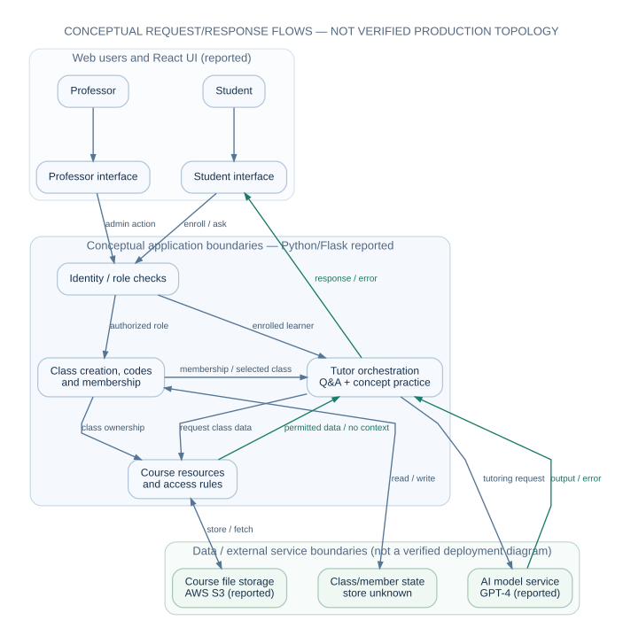

# System architecture — reconstructed logical view

> **Evidence label:** This is a **conceptual architecture reconstructed from product requirements**, not a reverse-engineered inventory of the deployed code. Technology names below are based on the project lead's account; internal architecture choices and interfaces are proposed explanatory constructs. See [provenance](provenance.md).

## Architectural drivers

The V1 PRD requires (1) distinct professor/student capabilities, (2) a classroom join mechanism, (3) class-associated materials, and (4) two course-aware AI interactions. Architecture must support those responsibilities without depending on the deferred LMS integration, generated lectures, interactive on-platform assessments or voice features.

## Reported technology and evidence boundary

| Reported historical technology | Plausible functional responsibility in this architecture | Confidence / limitation |
| --- | --- | --- |
| React | Professor/student browser interface | User-reported stack, not verified source code |
| Python / Flask | Application coordination and APIs | User-reported stack; endpoints and modules unknown |
| GPT-4 | AI-assisted Q&A and concept learning | User-reported model family; prompt/retrieval/evaluation scheme unknown |
| AWS S3 | Storage of uploaded teaching files | User-reported service; bucket details, encryption/configuration unverified |
| AWS EC2 | Application hosting compute | User-reported service; no verified instance, environment or network topology |

The original PRD and six-week plan **do not identify a database product**, an identity provider, a vector store, a queue or a framework for retrieving passages. They cannot be inferred from the reported stack. Any persistent data store necessary for identity, memberships and class metadata is shown only as an **unspecified conceptual capability**.

## Logical components and accountability

| Boundary | Responsibility | What it must receive / return | Important guardrail (proposed) |
| --- | --- | --- | --- |
| Professor web experience | Authentication entry, class creation/selection, outlines/topics/files | Session and authorized class list; admin actions | Distinguish professor privileges from student privileges |
| Student web experience | Sign-in, code search/join, course selection, AI mode/chat | Session, membership state, visible materials, AI interaction | Prevent cross-class disclosure |
| Identity and role gate | Associate caller with a user and effective role | Authenticated principal or rejection | Recheck server-side for each privileged action |
| Class / enrollment coordination | Class ownership, join code, membership and visibility | Validated class context or denial | Code possession alone must not grant unrelated data access |
| Learning-resource coordination | Upload, associate, organize and provide permitted files/topics | Authorized resource descriptors and content handles | Validate file boundaries and classroom ownership |
| Tutoring orchestration | Bind interaction to class, subject, and selected learning mode | Context selection and a student-facing response | Limit interaction to permitted class content; handle unavailable context |
| AI service boundary | Request Q&A or concept/practice/feedback behavior | Model response or model failure | Treat model output as untrusted, fallible educational content |
| Persistence / object storage | Retain course metadata and teaching resources | Authorized reads/writes | Storage implementation and protection details not verified |

These logical components **do not imply separate microservices or actual class/module names**. A single Flask application could fulfill several boundaries. Specific endpoints, DTOs and schemas remain deliberately unspecified.

## Conceptual interaction contracts (not historical endpoints)

| Interaction | Precondition | Required semantic input | Observable output | Negative / abuse case |
| --- | --- | --- | --- | --- |
| Create class | Authenticated professor | Classroom identity/metadata | Created owned class, possibly with no resources; code issuance is a separate operation | Student role denied; duplicate/invalid inputs handled |
| Join by code | Authenticated student | Code and caller identity | Explicit enrolled/not-enrolled result | Unknown/invalid code rejected without leaking class files; revocation is a proposed lifecycle extension |
| Upload material | Authorized professor for class | Content plus class association | Resource visible to permitted audience | Wrong class, malformed, oversized or unsupported upload rejected |
| Fetch resource (conditional student UI) | Ownership or, if supported, membership verified | Class and resource selection | Resource/data or denied/not-found | Direct student reads are a proposed option, not a source-confirmed V1 feature; cross-class access denied |
| Download professor resource | Owner authorized for class; requested file exists | Existing class resource | File bytes or denied/not-found | Foreign professor denied; source timeline separately planned generation, implementation unknown |
| Ask course question | Student enrolled in target class | Class context, question, Q&A mode | Contextual answer or disclosed uncertainty | Missing source context; injection-bearing document text |
| Practice concept | Student enrolled in target class | Class context, topic, concept mode, optional attempt | Explanation/problem/feedback | Ambiguous answer; model failure; unsafe content |

The names in this table describe **logical operations only**. There is no claim that these routes, schema fields or errors existed in the original implementation.

## Trust boundaries and information flows

**Professor course creation / resource upload:** Authorized professor → class/resource coordination → class metadata and course material storage → class-linked resource inventory. A rejected upload must not be presented as available to students.

**Student enrollment:** Authenticated student → class-code validation → recorded class membership → course dashboard/resource access. Validation of a code and authorization for a resource are separate checks.

**AI Q&A:** Authenticated, enrolled student → select class/Q&A → **request permitted context** from course resources → **receive selected data or explicit empty/error state** → send an AI request → **receive model output or error** → return a response to the student interface. The revised diagram distinguishes the request from the context/result and the AI request from its result. The original flowchart does not establish how material was parsed, selected or sent to GPT-4.

**Concept practice:** Authenticated, enrolled student → select class/concept mode → optionally use authorized class/topic context (without requiring an uploaded file) → explain/practice prompt → student answer → conceptual evaluation and feedback → retry or continue. The historical state representation and correctness algorithm are unknown.

The [AI interaction diagram](../diagrams/ai-interaction.svg) marks this sequence as a reconstruction.

## Security and privacy design review (proposed, not historical findings)

1. **Least privilege:** professor-only write actions, student tutor context authorized by enrollment; direct file-reading by students is optional proposed design and requires its own access tests if implemented. Server-side checks apply to every resource. Role UI hiding is insufficient.
2. **Class codes:** use unpredictable values, bound to a class, with proposed revocation/renewal rules for a future lifecycle policy; rate-limit validation, avoid leaking membership or classroom data before authorization.
3. **Uploaded materials:** enforce file-type and size restrictions, malware scanning where appropriate, safe extraction, safe content display, and time-limited authorized downloads. Do not trust document text as instructions for the model.
4. **Privacy:** assess institutional constraints, education records, retention, student ages, model-provider terms, redaction and deletion before deployment; use minimal personal data in AI requests.
5. **AI reliability:** model answers are advisory learning aids, not official grading or institutional fact; provide uncertainty and explicit error paths when course context is absent.
6. **Operational resilience:** surface upload failures, context retrieval timeouts, AI errors, invalid codes and access changes without exposing internal diagnostics.

None of these controls is independently confirmed as implemented. They form a technical risk and acceptance-review backlog rather than retrospective compliance claims.

## Architectural unknowns worth checking if the code becomes available

- Authentication lifecycle, password/session protections, credential recovery, and role enforcement.
- Database choice and relationships among users, classes, membership and resource metadata.
- Original object-storage layout, encryption, tenant separation and deletion semantics.
- File parsing, content index, retrieval selection and token/size budgeting.
- Whether model outputs were checked, grounded or logged, and how practice answers were evaluated.
- User privacy/consent and release operations, monitoring, restore strategy and reliability.

See [technical decisions](architecture-decisions.md), [traceability](traceability.md) and [risks](validation-and-risk.md).
