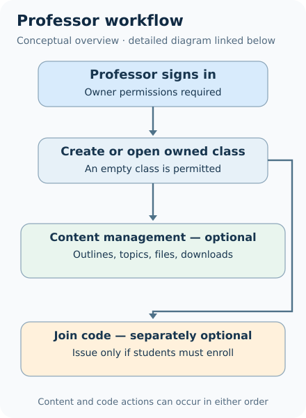
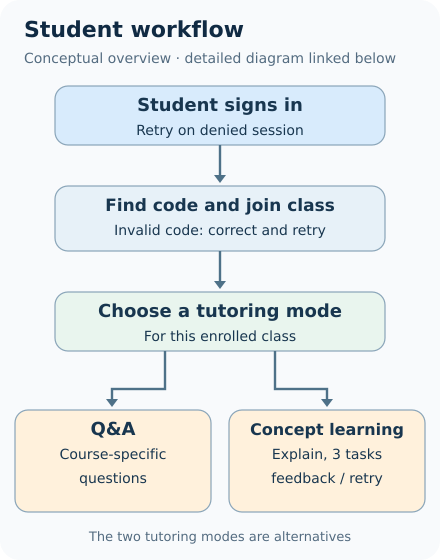

# Professor and student workflows

**Primary source:** Both workflow diagrams on p. 5 of the original PRD, read visually and cross-checked against the V1 feature table (§2.2) and the future-scope table (§3.1). The diagrams below **redraw the process conceptually** rather than reproducing the employer-owned graphics or asserting exact screens.

## Professor: course setup and administration

[Open the detailed professor process diagram](../diagrams/professor-workflow.svg) for every optional resource operation, branch, and authorization edge. The compact view deliberately summarizes them for legibility; it is not an additional historical workflow.

1. **Authenticate as professor.** The original flow begins with professor login leading to a professor dashboard.
2. **Select an existing class or create a new one.** R18 represents one class-creation operation; R10 selects the **empty-class branch within that operation**, rather than creating a second class. A class can exist with zero teaching files.
3. **Organize materials.** The source covers course outlines, exam/quiz resources, textbook topics, and general uploads. *Store exams and quizzes* in the MVP means storing information or related resources, not necessarily files only; an interactive test-taking/grading platform is outside V1.
4. **Manage the class and code.** A join code is an **optional, independent class operation** (`R03`) and can be issued after or before resource management as needed, irrespective of whether materials have been uploaded. The exact issuance, expiration and revocation policy is unspecified.
5. **Handle available resources.** The V1 professor dashboard includes assignment/test downloads (`R11`); the original diagram also includes future integration paths. Direct Canvas upload appears there despite being expressly deferred by PRD §2.3. **V1 excludes direct LMS integration.** Student resource-download permissions are not independently specified. The Week 4 timeline **planned generation of downloadable assignments and tests**, whereas the V1 PRD feature table says *Assignments Download*; actual generation and download behavior cannot be established from the available implementation evidence.
6. **Classroom remains usable when initially empty.** Student access can exist before a resource corpus exists, but course-grounded answers cannot be presumed when materials are missing.

**Error and authorization analysis — proposed:** Reject professor actions on another professor's classes, invalid documents, duplicate enrollment invitations and failed uploads; preserve a clear empty-class state.

## Student: enrollment and tutoring

[Open the detailed student process diagram](../diagrams/student-workflow.svg) for code-retry paths, subject-context preparation, and separate answer-feedback branches. The compact view omits details for narrow-screen readability.

1. **Authenticate as a student.** The student diagram shows retry on authentication failure.
2. **Enter/search a classroom code.** A code-found path goes to joining the class; an invalid/not-found code prompts correction and retry. The source does not specify whether a searchable directory or a direct exact-code lookup existed.
3. **Prepare class-specific AI context.** The source places a pre-initialization/context step after joining. The source drawing illustrates combining subject/class/professor teaching information; the exact filename example in that diagram is an illustration, not proof of a deployed naming convention.
4. **Choose the tutoring experience.** One mode supports subject Q&A; another explains concepts and provides practice questions.
5. **Receive course-grounded educational interaction.** The Q&A branch uses subject data for answers. The original learning branch describes explaining a concept, providing **three practice problems**, and evaluating answers, with retry after incorrect attempts and progression after correct answers.
6. **Respect missing-content states.** The original source does not specify model behavior when no permitted content is available; disclosing that limitation is a **recommended** rule.

**Original diagram ambiguity:** The flowchart's loop from answer correctness into subsequent learning stages does not define an authoritative scoring engine or durable gradebook. This case study treats answer evaluation as **formative practice feedback**, not official assessment.

## Returning to an existing class — proposed verification

The original professor-side flowchart contains a **Select Existing Class** branch. To make that source behavior testable, prospective scenario **S18** reauthenticates the original professor in a genuinely new session, reopens the same owned class, and verifies persisted outline/material identifiers and bytes. A second professor attempts the same selection and is denied server-side. The PRD does not document the exact implementation API, database schema or persistence layer, and no historical test run has been observed. See [S18 acceptance assertions](../examples/synthetic-acceptance-scenarios.md#s18--reopen-existing-classroom-after-a-new-professor-session).

## Role/access matrix (recommended security model)

| Operation | Unauthenticated | Student outside class | Enrolled student | Owner professor |
| --- | --- | --- | --- | --- |
| Sign in | Allowed | — | — | — |
| Create class | Denied | Denied | Denied | Allowed |
| Obtain permitted join result | Denied | Limited validation only | Limited validation only | Class-specific management |
| Directly view class resources (conditional proposed UI) | Denied | Denied | Conditional; not a verified V1 feature | Allowed |
| Upload/edit teaching resources | Denied | Denied | Denied | Allowed |
| Download an existing professor-managed assignment | Denied | Denied | Not established by source | Allowed |
| Interact with class tutor | Denied | Denied | Allowed | Not defined in original student-focused V1 |

**Direct student resource viewing is conditional**, with no dedicated V1 acceptance oracle; the only covered source-data retrieval path is class-scoped AI Q&A (R14). If a future build exposes direct viewing, independently test successful member reads and denied nonmember/cross-class reads before enabling it. **This matrix is a proposed, minimal defensible policy**, not evidence of implemented authorization. Classroom co-teachers, administrators, anonymous access and invitations were not specified in the source.

## Critical cross-flow invariants

- A student's membership must be attached to the same class whose resources are presented to the AI mode.
- Class codes allow joining a class; they are not permanent credentials for reading all resources.
- An upload associated with Class A must not be fetched for Class B.
- Student feedback should remain inside the chosen learning interaction and should not silently become a recorded grade.
- Future-feature UI entries must be visibly unavailable, not presented as active services.

## High-value validation cases

Scenario examples and test oracles appear in [synthetic acceptance scenarios](../examples/synthetic-acceptance-scenarios.md), with [assertion-level coverage](acceptance-coverage.md). These were designed for a future testable system and **have not been executed against historical code**.
